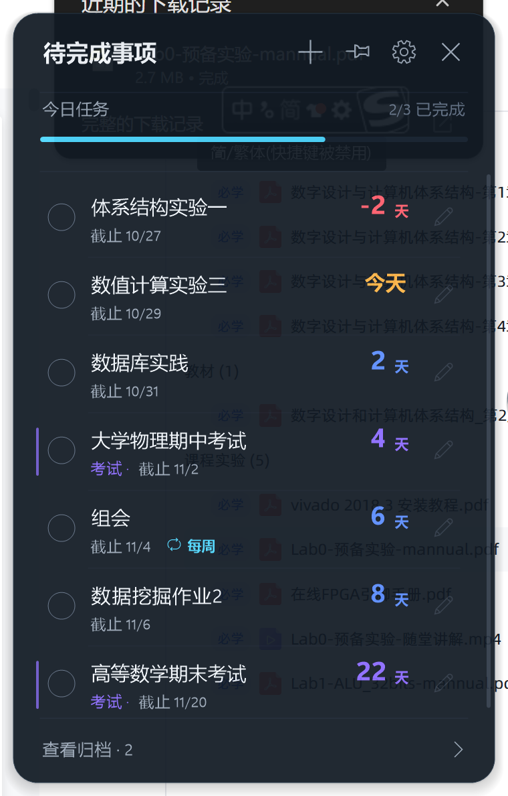
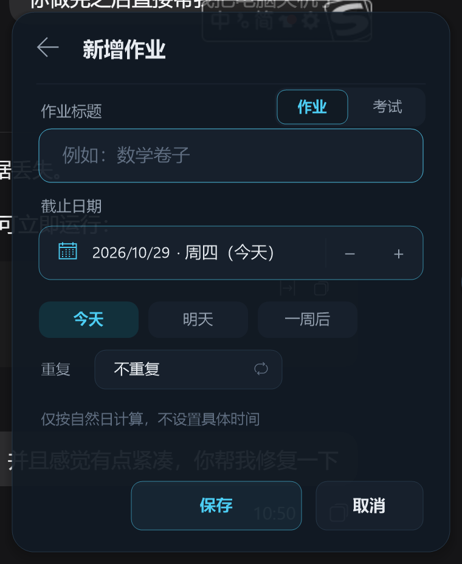
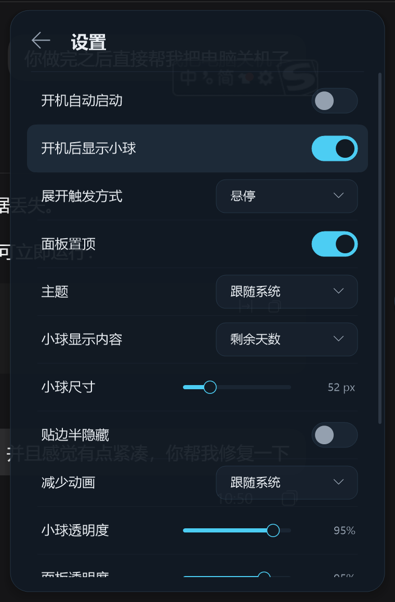
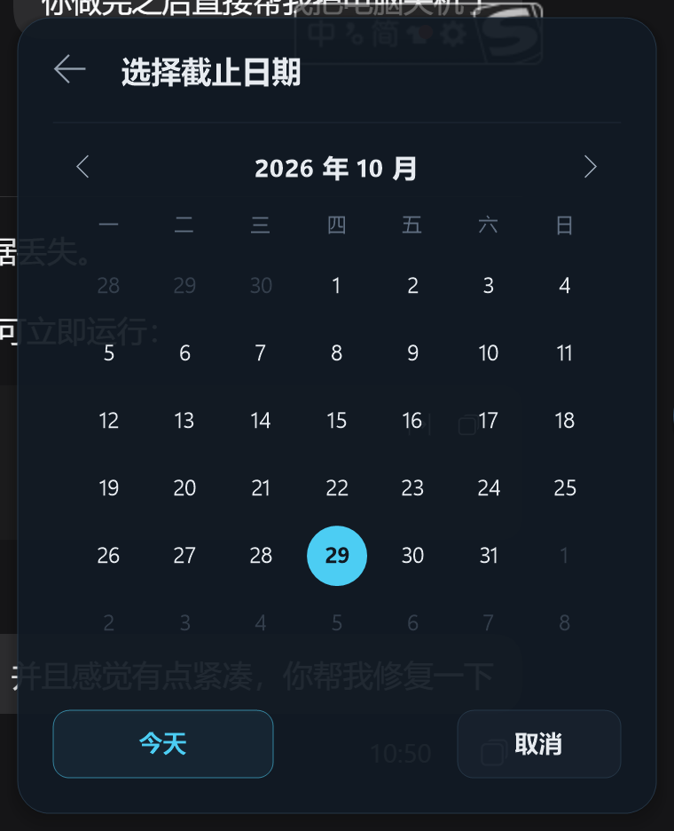
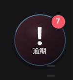

<div align="center">

# Homework Float · 作业悬浮球

**把作业和考试，变成桌面上的一颗小球。**

一个为 Windows 写的原生待办悬浮球：平时安静地贴在屏幕边缘，鼠标扫过就能看见今天还有什么没做。

[](https://www.microsoft.com/windows)
[](https://en.cppreference.com/w/cpp/20)
[](https://learn.microsoft.com/windows/win32/)
[](https://learn.microsoft.com/windows/win32/gdiplus/-gdiplus-gdi-start)
[](#-快速开始)
[](build.bat)

<br/>



</div>

---

## 为什么做这个项目

大多数待办工具都要求你先打开一个应用、一个网页，或者一个总在变的侧边栏。对“今天有哪些作业”这种小事来说，路径太长。

Homework Float 把入口缩到一颗小球：

- **不占任务栏**，贴在屏幕边缘，需要时出现，不需要时消失。
- **悬停即看**，不用点开一级级菜单。
- **离线、单文件、无依赖**，不登录、不联网、不上传。
- **为作业和考试设计**，不是通用项目管理工具的减法版。

它没有云同步，也没有 AI 助手。它只做一件事：让你在关掉电脑之前，想起来还有一份作业没交。

## ✨ 功能

| | |
| --- | --- |
| **桌面悬浮球** | 贴边、拖拽吸附、悬停/点击展开、自动收起、半隐藏、透明度与尺寸调节。 |
| **今日总览** | 顶部显示今日任务数、完成进度和一条轻量进度条；打开就知道今天还剩多少。 |
| **剩余天数** | 标题行右侧用大号数字突出“N 天 / 今天 / 逾期”，按临近程度自动变色。 |
| **作业与考试** | 两种类型分开管理；考试使用克制的紫色侧条和“考试 · 截止日期”标识。 |
| **周期任务** | 支持每天、每周、每月重复；完成后自动生成下一次，旧记录进入归档。 |
| **快速日期** | 今天 / 明天 / 一周后一键设置，也可以打开月历选择任意日期。 |
| **归档与恢复** | 完成的任务进入归档，可恢复、可删除、可一键清空。 |
| **专注细节** | 完成划除动画、空标题光标、手型/文本光标、悬停高光、减少动画模式。 |
| **深色 / 浅色** | 跟随系统，也可以手动切换；深色为冷调玻璃质感，浅色为冷白灰蓝。 |
| **托盘与自启** | 托盘菜单控制显示、面板、设置和退出；支持开机自动启动。 |
| **数据安全** | 本地 JSON、原子写入、每日备份、损坏恢复、日志轮转、单实例。 |

## 📸 界面

<div align="center">

| 待办面板 | 新增任务 |
| :---: | :---: |
|  |  |

| 设置 | 月历 |
| :---: | :---: |
|  |  |



</div>

## 🚀 快速开始

### 环境要求

- Windows 10 1809+ 或 Windows 11
- Visual Studio 2022，安装 **使用 C++ 的桌面开发** 工作负载
- Windows 10/11 SDK

项目没有 vcpkg、CMake 或第三方运行时依赖。`build.bat` 会调用 MSVC，使用 `/MT` 静态链接 CRT，最终只产出一个 EXE。

```bat
git clone git@github.com:Aplaoi/easy-todo.git
cd easy-todo
build.bat
```

输出：

```text
build\HomeworkFloat.exe
```

直接运行即可：

```bat
build\HomeworkFloat.exe
```

> `build.bat` 默认使用 `D:\VisualStudio\VC\Auxiliary\Build\vcvars64.bat`。如果你的 Visual Studio 安装在别的路径，修改脚本顶部的 `VCVARS` 变量即可。

首次启动会创建数据目录，并在托盘显示一次提示。可以在设置中开启“开机自动启动”。

## 🖱️ 使用方式

| 操作 | 效果 |
| --- | --- |
| 悬停小球 | 发光并展开面板（可改为“仅点击展开”） |
| 单击小球 | 展开 / 收回面板 |
| 拖动小球 | 移动位置，松手后自动吸附到屏幕边缘 |
| 点击图钉 | 固定 / 取消固定面板 |
| 点击任务标题或复选框 | 完成任务并归档 |
| 点击任务右侧铅笔 | 编辑任务 |
| 右键任务 | 编辑、完成、复制标题、删除 |
| 点击日期区域 | 打开月历 |
| 点击“今天 / 明天 / 一周后” | 快速设置截止日期 |
| 面板内按 `Esc` | 返回上一级 / 关闭面板 |
| 托盘左键 / 右键 | 显示隐藏小球 / 打开菜单 |

新增任务时按 `Enter` 保存，按 `Esc` 取消。

## 🧱 技术实现

```text
┌─────────────────────┐        hover / click        ┌─────────────────────┐
│   Ball window       │ ──────────────────────────▶ │   Panel window      │
│   32bpp layered     │                             │   List / Form       │
│   snap + animation  │ ◀────────────────────────── │   Calendar / Archive│
└──────────┬──────────┘        mouse leave          │   Settings          │
           │                                        └──────────┬──────────┘
           │                                                   │
           └───────────────────────┬───────────────────────────┘
                                   ▼
                     ┌──────────────────────────┐
                     │  Task / Settings model   │
                     │  JSON store + backups    │
                     │  atomic replace + logs   │
                     └──────────────────────────┘
```

- **纯 Win32 + GDI+**：没有 UI 框架，两个分层窗口（悬浮球、面板）通过 `UpdateLayeredWindow` 呈现 32bpp 半透明画面。
- **自绘控件**：按钮、开关、下拉框、滑块、月历全部由 `panel.cpp` 直接绘制和命中测试。
- **Per-Monitor V2**：所有尺寸以 DIP 定义，按显示器 DPI 缩放；支持多显示器与不同缩放比例。
- **本地优先**：任务和设置保存在 `%APPDATA%\HomeworkFloat\`，没有网络代码。
- **可恢复写入**：先写临时文件并 `FlushFileBuffers`，再用 `ReplaceFileW` / `MoveFileEx` 原子替换；异常文件会被保留，并尝试从备份恢复。

### 代码结构

```text
src/
  main.cpp      wWinMain、单实例、DPI、GDI+ 生命周期
  app.h/.cpp    窗口、托盘、几何/DPI、动画、消息循环
  panel.cpp     面板布局、列表/表单/月历/归档/设置、鼠标键盘、任务操作
  paint.h/.cpp  GDI+ 双缓冲画布、圆角/文字/阴影/分层窗口呈现
  model.h/.cpp  Task/Settings、日期换算、排序、文案
  store.h/.cpp  加载/保存/备份/恢复/日志
  json.h/.cpp   轻量 JSON 解析与序列化
  common.h      Win32/GDI+ 头、UTF-8 转换、路径工具
  app.manifest  PerMonitorV2、asInvoker、Common Controls v6
```

## 💾 数据与隐私

所有数据都在本机：

```text
%APPDATA%\HomeworkFloat\
  tasks.json          作业与考试
  settings.json       界面与行为设置
  backups\            每日备份，默认保留最近 7 份
  logs\app.log        运行日志，按大小轮转
```

- **没有账号，没有网络请求，没有遥测。**
- 每次保存都使用临时文件 + 原子替换，避免写到一半损坏。
- 损坏的 JSON 会被重命名保留，并自动尝试最近备份。
- 保存失败时面板顶部会出现可点击的重试提示。

开发或测试时，可以用独立数据目录，避免碰到真实数据：

```bat
set HF_DATA_DIR=%CD%\build\testdata
build\HomeworkFloat.exe
```

## ⚙️ 设置

- 开机自动启动
- 开机后显示小球
- 展开触发方式：悬停 / 仅点击
- 面板置顶
- 主题：跟随系统 / 深色 / 浅色
- 小球显示内容：剩余天数 / 任务计数
- 小球尺寸
- 贴边半隐藏
- 减少动画
- 小球透明度

设置修改后即时生效并写入 `settings.json`。

## 🗺️ Roadmap

- [x] 悬浮球、拖拽吸附、半隐藏、多显示器
- [x] 作业 / 考试、截止日期、剩余天数
- [x] 每天 / 每周 / 每月周期任务
- [x] 月历、归档、恢复、清空归档
- [x] 深色 / 浅色主题、设置面板、托盘、自启
- [ ] 拖拽排序
- [ ] 导入 / 导出
- [ ] 全局快捷键
- [ ] 更细的完成/收起动效

## ❓ FAQ

**为什么是单个 EXE？**

作业提醒不需要 Electron。原生实现启动快、内存小，也不会因为运行时更新而突然打不开。

**支持 macOS / Linux 吗？**

目前只支持 Windows。代码大量使用 Win32 分层窗口和 GDI+，不是简单换个 UI 框架就能跨平台。

**会同步到云端吗？**

不会。这个项目的默认假设是“作业数据只属于你自己”。

**Windows 提示未知发布者怎么办？**

这是个人构建的未签名 EXE。你可以自行用 Visual Studio 编译，或用自己的代码签名证书签名。

**为什么杀毒软件偶尔误报？**

未签名、单文件、自解压式的小工具容易被启发式规则注意。源码和构建脚本都在仓库里，可以自行审计和编译。

## 🤝 Contributing

欢迎提 Issue 和 PR。提交前建议：

1. 先运行 `build.bat`，确保没有新增警告。
2. 不要引入网络请求、账号体系或第三方运行时依赖。
3. 修改 UI 时附上截图；修改数据逻辑时说明迁移/兼容策略。
4. 测试时使用 `HF_DATA_DIR` 指向临时目录，不要提交个人任务数据。

如果这个项目帮你少忘记一次作业，欢迎点一个 ⭐。

## 📚 文档

- [功能与交互说明](docs/功能与交互说明.md)
- [UI 重设计说明](docs/UI重设计说明.md)

## 📄 License

暂未指定开源许可证。代码可阅读、可自行编译；如需分发或商用，请先联系作者。